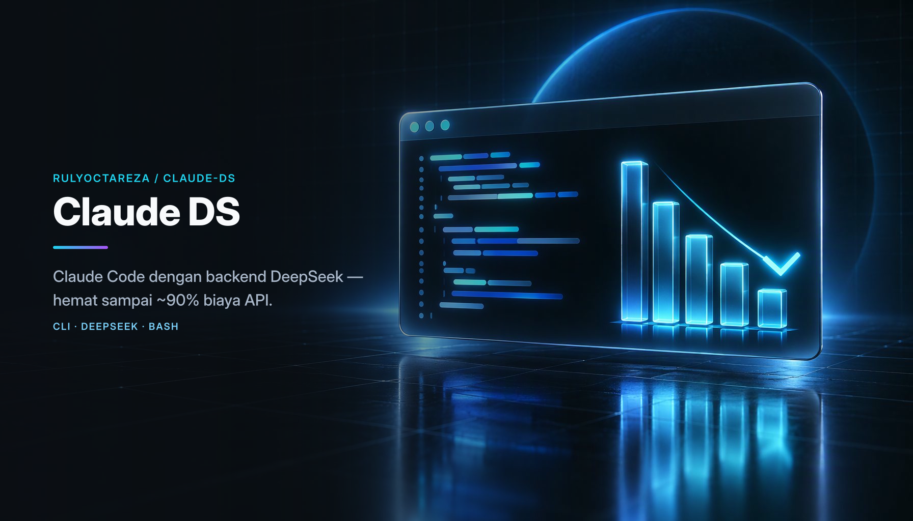

<p align="center">
  
</p>

<h1 align="center">claude-ds</h1>

<p align="center">
  <b>Claude Code dengan backend DeepSeek — hemat sampai ~90% biaya API.</b><br>
  CLI yang sama, model yang lebih murah
</p>

<p align="center">
  
  
  
</p>

---

## ✨ Preview

<p align="center">
  
</p>

> **Catatan:** gambar di atas adalah *ilustrasi konsep*, bukan screenshot asli.

---

## 📖 Tentang

Menjalankan **Claude Code** memakai model **DeepSeek** (R1, V4) lewat endpoint API yang
kompatibel dengan Anthropic. Pengalaman CLI tetap sama, backend-nya saja yang berbeda —
dengan penghematan biaya sekitar 90% dibanding Anthropic langsung.

---

## 📦 Prasyarat

- [Claude Code](https://claude.ai/code) terpasang
  ```bash
  npm install -g @anthropic-ai/claude-code
  ```
- API key dari [platform.deepseek.com](https://platform.deepseek.com)

---

## 🚀 Instalasi

```bash
# 1. Simpan API key
mkdir -p ~/.config/deepseek
cp key.env.example ~/.config/deepseek/key.env
chmod 600 ~/.config/deepseek/key.env
# edit file di atas, paste API key DeepSeek

# 2. Pasang wrapper
cp claude-ds /usr/local/bin/claude-ds
chmod +x /usr/local/bin/claude-ds

# atau symlink
# ln -sf "$PWD/claude-ds" ~/.local/bin/claude-ds
```

---

## 💻 Penggunaan

```bash
claude-ds                  # jalankan Claude Code via DeepSeek
claude-ds --bare           # tanpa hooks/plugins
claude-ds "some prompt"    # one-shot lewat stdin
```

---

## ⚙️ Cara Kerja

1. Wrapper membaca `DEEPSEEK_API_KEY` dari `~/.config/deepseek/key.env`
2. Set environment: `ANTHROPIC_BASE_URL` → `api.deepseek.com/anthropic`,
   model → `deepseek-v4-pro[1m]` / `deepseek-v4-flash`
3. Menjalankan `claude --settings` dengan konfigurasi JSON yang di-generate

Tidak perlu login/OAuth Anthropic — semua trafik lewat API DeepSeek.

---

## 🤖 CI / Dev Container

Untuk environment otomatis, set env langsung:

```bash
export ANTHROPIC_BASE_URL="https://api.deepseek.com/anthropic"
export ANTHROPIC_API_KEY="sk-..."
export ANTHROPIC_MODEL="deepseek-v4-pro[1m]"
export ANTHROPIC_DEFAULT_HAIKU_MODEL="deepseek-v4-flash"
export CLAUDE_CODE_SUBAGENT_MODEL="deepseek-v4-flash"
export CLAUDE_CODE_EFFORT_LEVEL="max"

claude --daemon
```

---

## 📝 Catatan

- `deepseek-v4-pro[1m]` untuk reasoning berat, `deepseek-v4-flash` untuk cepat/ringan
- Beberapa fitur Claude (auth MCP server, Artifacts) bisa berperilaku berbeda via DeepSeek
- Panduan integrasi resmi: [DeepSeek docs](https://api-docs.deepseek.com/quick_start/agent_integrations/claude_code)
